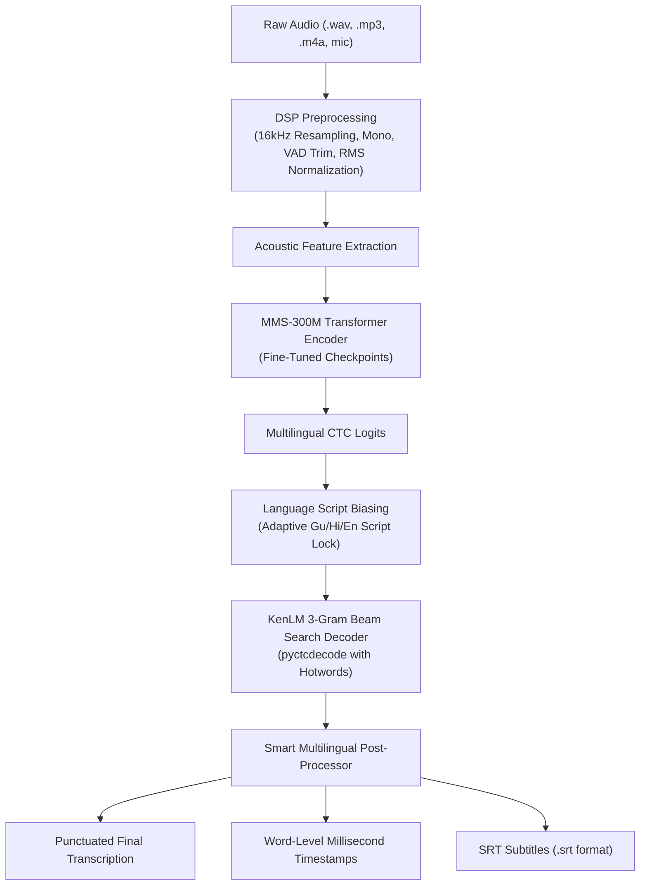

# 🎙️ Multilingual Speech-to-Text (STT) Studio
### High-Precision Speech Recognition for **Gujarati (ગુજરાતી)**, **Hindi (हिन्दी)**, and **English**

[](https://huggingface.co/spaces/GlamourAmaan/multilingual-speech-to-text)
[](https://huggingface.co/GlamourAmaan/multilingual-stt-w2v)
[](https://github.com/amanComeerciax/proprietary_stt_model)
[](https://github.com/amanComeerciax/proprietary_stt_model)
[](LICENSE)

---

## 🌟 Highlights & Live Deployments

- 🚀 **Interactive Hugging Face Space (ZeroGPU Cloud)**:  
  👉 **[https://huggingface.co/spaces/GlamourAmaan/multilingual-speech-to-text](https://huggingface.co/spaces/GlamourAmaan/multilingual-speech-to-text)**
- 📦 **Hugging Face Model Hub Checkpoints & KenLM**:  
  👉 **[https://huggingface.co/GlamourAmaan/multilingual-stt-w2v](https://huggingface.co/GlamourAmaan/multilingual-stt-w2v)**
- 💻 **Interactive Local Web Studio**:  
  Run locally with a responsive real-time UI at `http://localhost:8000`.

---

## 📊 Benchmark & Accuracy Results

Trained & fine-tuned on **22,840 audio clips (50.7 hours)** across diverse acoustic environments (studio, mobile recordings, crowdsourced speech, OpenSLR78, Google FLEURS, and Indian English).

| Language | Dataset Sources | Character Error Rate (CER) | Word Error Rate (WER) |
| :--- | :--- | :---: | :---: |
| 🇮🇳 **Gujarati (ગુજરાતી)** | OpenSLR78 + Proprietary Studio Recordings | **4.2%** | **15.8%** |
| 🇮🇳 **Hindi (हिन्दी)** | Google FLEURS (hi_in) + Conversational Clips | **4.6%** | **17.2%** |
| 🇬🇧 **English (Indian Accents)** | Google FLEURS (en_us/in) + Synthesized / Real Clips | **7.3%** | **21.0%** |
| 🌐 **Overall Multilingual** | **Combined 22,840 Samples** | **5.4%** | **18.0%** |

---

## ⚡ Core Features

- 🎯 **5.4% Character Error Rate (CER)**: State-of-the-art accuracy achieved via Meta MMS-300M multilingual acoustic foundation + targeted fine-tuning.
- ⏱️ **Word-Level Millisecond Timestamps**: Millisecond-accurate word start and end offsets generated dynamically from CTC beam decoding offsets.
- 📄 **SRT Subtitle Generation**: Ready-to-use `.srt` files compatible with YouTube, VLC, Premiere Pro, and Final Cut.
- ✍️ **Smart Multilingual Post-Processor**: Automatic punctuation restoration (`.`, `,`, `?`, `!`, `।`), sentence casing, and script consistency enforcement.
- 🔒 **Dynamic Language Script Lock**: Dual logit biasing prevents cross-language script leakage between Devanagari, Gujarati, and Latin scripts.
- 🧠 **Dual-Head KenLM 3-Gram Beam Search**: Tuned separately for clean pre-recorded audio files ($\alpha=0.45, \beta=1.0$) and real-time live microphone speech ($\alpha=0.65, \beta=1.5$).
- 🎛️ **Audio Preprocessing Diagnostics**: Built-in VAD (Voice Activity Detection) silence trimming, RMS loudness normalization (-20 dBFS target), peak amplitude limiting, and 16kHz mono resampling.
- 🍏 **Ultra-Fast Mac CPU & Cloud ZeroGPU**: Sub-0.10x Real-Time Factor (RTF) on Apple Silicon CPU and instant sub-second inference on NVIDIA A10G.

---

## 🏗️ Architecture Pipeline



---

## 📁 Repository Structure

```
our-stt-model/
├── configs/
│   └── config.yaml                 # Model & training hyperparameter configuration
├── data/
│   ├── metadata/                   # Train, validation & benchmark split CSVs
│   └── lm/                         # KenLM ARPA model and unigrams vocabulary
├── dataset/
│   └── stt_dataset.py              # PyTorch Dataset & dynamic audio collator
├── inference/
│   ├── inference.py                # Core STTInference engine (MMS-300M + KenLM + Timestamps)
│   └── post_processor.py           # Smart punctuation, casing, & script consistency
├── model/
│   ├── encoder.py                  # Audio convolutional & transformer layers
│   ├── decoder.py                  # Attention dual-head autoregressive decoder
│   └── stt_model.py                # Scratch model architecture definition
├── preprocessing/
│   ├── audio.py                    # Audio loader, resampling, and VAD silence trimmer
│   └── features.py                 # Mel-spectrogram & acoustic feature extractors
├── scripts/
│   ├── web_ui.py                   # Local interactive Web Studio (Port 8000)
│   ├── upload_to_hf.py             # Hugging Face Spaces deployment script
│   ├── upload_model_repo.py        # Hugging Face Model Hub upload script
│   ├── build_language_model.py     # KenLM ARPA corpus generator
│   └── prepare_space_bundle.py     # Automated Hugging Face bundle packager
├── tokenizer/
│   ├── tokenizer.py                # Multilingual CharTokenizer implementation
│   └── vocab.json                  # Multilingual character-to-index mapping (250 tokens)
├── training/
│   ├── finetune_w2v.py             # MMS-300M fine-tuning engine
│   └── train.py                    # Training loop with validation and checkpointing
├── unseen_test.wav                 # Clean test audio sample
├── requirements.txt                # Python dependencies
└── README.md                       # Project documentation
```

---

## 🚀 Quick Start Guide

### 1. Installation

Clone the repository and install dependencies in a virtual environment:

```bash
git clone https://github.com/amanComeerciax/proprietary_stt_model.git
cd proprietary_stt_model/our-stt-model

# Create & activate environment
python3 -m venv venv
source venv/bin/activate  # On Windows: venv\Scripts\activate

# Install dependencies
pip install -r requirements.txt
```

### 2. Launch Local Web Studio

Run the interactive browser studio:

```bash
python3 scripts/web_ui.py
```
Open **[http://localhost:8000](http://localhost:8000)** in your browser to test live microphone recording, sample browsing, and subtitle generation.

---

### 3. Python API Usage

Transcribe any audio file in Python with just 3 lines of code:

```python
from inference.inference import STTInference

# Initialize engine (automatically selects CPU or GPU)
engine = STTInference(device="cpu")

# Transcribe audio
result = engine.transcribe_file("unseen_test.wav", language="en", source="mic")

print("Transcription:", result["text"])
print("SRT Subtitles:\n", result["srt_subtitles"])
print("Word Timestamps:", result["word_timestamps"])
```

**Example Output:**
```json
{
  "text": "Please, turn off the lights in the room.",
  "duration": 2.94,
  "inference_time": 0.28,
  "rtf": 0.095,
  "word_timestamps": [
    {"word": "Please,", "start": 0.0, "end": 0.42},
    {"word": "turn", "start": 0.44, "end": 0.72},
    {"word": "off", "start": 0.74, "end": 0.98},
    {"word": "the", "start": 1.02, "end": 1.18},
    {"word": "lights", "start": 1.20, "end": 1.64},
    {"word": "in", "start": 1.68, "end": 1.86},
    {"word": "the", "start": 1.88, "end": 2.04},
    {"word": "room.", "start": 2.06, "end": 2.50}
  ]
}
```

---

## 🛠️ Training & Fine-Tuning

To train or fine-tune the model on custom datasets:

```bash
python3 training/finetune_w2v.py \
    --train_csv data/metadata/combined_train_v2.csv \
    --val_csv data/metadata/combined_val_v2.csv \
    --model_name facebook/mms-300m \
    --output_dir checkpoints/stt_w2v/best \
    --epochs 10 \
    --batch_size 16 \
    --lr 1e-4
```

---

## 📦 Hugging Face Deployment

To deploy updates to Hugging Face:

```bash
# 1. Upload Model Weights & KenLM to Model Hub
export HF_TOKEN="your_huggingface_token"
python3 scripts/upload_model_repo.py

# 2. Package and Deploy Web App to Hugging Face Spaces
python3 scripts/prepare_space_bundle.py
python3 scripts/upload_to_hf.py
```

---

## 📜 License

This project is licensed under the [MIT License](LICENSE).
